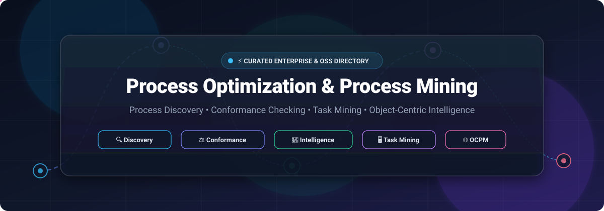
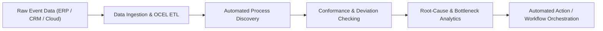

# 🚀 Awesome Process Optimization & Process Mining

  

  
  
  
  
  
  
  
  

---

## 📖 Overview & SEO Summary

A curated directory and comparative guide to the **Process Optimization**, **Process Mining**, and **Process Intelligence** ecosystem. This repository tracks market-leading **enterprise SaaS platforms** and **active open-source libraries** enabling organizations, researchers, data scientists, and transformation leaders to extract actionable insights from event logs, discover actual end-to-end workflows, verify conformance against reference models, and trigger intelligent process automation.

### 🔑 Key Topic Coverage
- **Process Discovery**: Automated reconstruction of process models (Petri nets, BPMN, DFGs) directly from enterprise event logs (`XES`, `OCEL 2.0`, `CSV`).
- **Conformance Checking**: Token-based replay, alignments, and deviation diagnostics comparing actual digital footprints against intended standard operating procedures (SOPs).
- **Object-Centric Process Mining (OCPM)**: Modern multi-perspective process modeling overcoming single-case limitations across interconnected entities (orders, items, deliveries, invoices).
- **Task Mining & Desktop User Interaction**: Non-intrusive logging of keystrokes, application switches, and clicks to bridge systemic audit gaps.
- **Predictive Process Monitoring**: Machine learning and Graph Neural Networks (GNNs) forecasting remaining cycle time, SLA breaches, and outcome risks.

---

## 📑 Table of Contents
- [📊 Sector Overview & Market Dynamics](#-sector-overview--market-dynamics)
- [🏢 Enterprise SaaS & Commercial Platforms](#-enterprise-saas--commercial-platforms)
- [💻 Open-Source Repositories & Libraries](#-open-source-repositories--libraries)
- [🔬 Academic Hubs & Foundational Frameworks](#-academic-hubs--foundational-frameworks)
- [📐 Standards & Open Data Formats](#-standards--open-data-formats)
- [🤝 How to Contribute](#-how-to-contribute)
- [💖 Support & Sponsoring](#-support--sponsoring)
- [⭐ Star History](#-star-history)
- [⚖️ Disclaimer](#️-disclaimer)

---

## 📊 Sector Overview & Market Dynamics

The global **Process Mining & Process Optimization** market was valued at approximately **$1.8 Billion in 2024** and is projected to surpass **$12.5 to $14.8 Billion by 2030–2032**, expanding at a compound annual growth rate (**CAGR of ~42–48%**). 

The sector exhibits a **moderately concentrated, "winner-take-most" market structure**: category pioneer **Celonis** holds over **45% of total market share**, while hyperscale enterprise software giants (Microsoft, SAP, IBM, ServiceNow, and UiPath) have aggressively consolidated the market via acquisitions (Minit, Signavio, myInvenio) to embed process intelligence directly into their cloud ERP, ITSM, and RPA ecosystems.

---

## 🏢 Enterprise SaaS & Commercial Platforms

The table below catalogs premier commercial and SaaS solutions, sorted in descending order by **Company Size (Market Capitalization / Enterprise Valuation / Annual Revenue)**.

| Platform / Vendor | Company Size (Valuation / Rev) | Starting Tier Pricing | Free Tier / Free Trial Limits | Primary Focus & Core Capabilities |
| :--- | :--- | :--- | :--- | :--- |
| **[Microsoft Power Automate Process Mining](https://www.microsoft.com/en-us/power-platform/products/process-mining)** | **~$3.10T** Market Cap *(~$245B Ann. Rev)* | **$15/user/month** *(Power Automate Premium, contributes 50 MB capacity)* or **$5,000/tenant/month** *(Process Mining Add-on for 100 GB pooled capacity)* | **30-day free trial** of Power Automate Premium with basic process and task mining entitlements | Cloud-native process discovery, task mining desktop recorder, Power BI visualization, and pre-built Azure / Dataverse connectors. |
| **[SAP Signavio](https://www.signavio.com/)** | **~$260B** Market Cap *(~$34B Ann. Rev)* | **~$2,000/user/year** *(~$167/user/month for commercial Process Transformation Suite seats)* | **30-day free trial** of Process Transformation Suite *(non-productive PoC workspace, capped log uploads, BPMN modeling)* | Process Transformation Suite, SIGNAL query language, 500+ built-in KPIs, automated actions, and native SAP S/4HANA ERP integrations. |
| **[IBM Process Mining](https://www.ibm.com/products/process-mining)** | **~$215B** Market Cap *(~$62B Ann. Rev)* | **$4,250/month** *(AWS Marketplace SaaS annual commitment; 20 GB storage, 3 business users, 1 analyst)* or **$2,885/month** *(on-prem)* | **30-day free trial** capped at **1 GB data upload** *(pre-loaded Credem bank enterprise dataset, process simulation)* | Multi-level process mining, automated root-cause analysis, what-if digital twin simulations, and IBM Cloud Pak automation hooks. |
| **[ServiceNow Process Optimization](https://www.servicenow.com/products/process-optimization.html)** | **~$190B** Market Cap *(~$10.5B Ann. Rev)* | **~$100–$160/fulfiller/month** *(packaged within ITSM Advanced / Enterprise)* or **~$75/user/month** *(modular add-on)* | **15 to 30-day sales-guided Proof of Concept (PoC)** sandbox; free Personal Developer Instances (PDIs) with core ITSM *(audit plugin restricted)* | In-platform audit log mining (`sys_audit`), visual bottleneck discovery, SLA breach diagnostics, and Continual Improvement Management. |
| **[Celonis](https://www.celonis.com/)** | **~$13.0B** Valuation *(~$500M+ ARR)* | **~$150,000/year** *(~$12,500/month starting departmental pilot package for 1–3 core processes like P2P or O2C)* | **Free Forever plan** *(formerly Celonis Snap)* capped strictly at **1 GB data volume**, CSV/file uploads only, community support | Gartner MQ Category Leader, Object-Centric Process Mining (OCPM), Process Intelligence Graph, AgentC AI orchestration, and multi-system digital twins. |
| **[UiPath Process Mining](https://www.uipath.com/product/process-mining)** | **~$7.5B** Market Cap *(~$1.4B Ann. Rev)* | **$420/month** *(Automation Cloud Pro; process mining capacity metered at 1 Platform Unit per 625 event log rows)* | **60-day Enterprise/Pro free trial** *(capped at 1,000,000 rows / AI flex units)*; or free up to 10,000 rows on Maestro Process apps | Seamless bridge between process mining, task mining, and RPA bot execution; 50+ pre-built connectors for SAP, Salesforce, and Oracle. |
| **[Software AG ARIS](https://www.aris.com/)** | **~$2.6B** Enterprise Value *(~$1.0B Ann. Rev; Silver Lake)* | **~$120–$150/user/month** *(ARIS Cloud starter seats)* or **~$30,000/year** enterprise tier | **ARIS Process Mining Elements free tier** *(indefinite evaluation, CSV upload capped at 100,000 events)* or **30-day ARIS Cloud trial** | Process mining deeply coupled with ARIS enterprise architecture repository; automated conformance checking against BPMN/EPC models. |
| **[ABBYY Timeline](https://www.abbyy.com/timeline/)** | **~$1.0B** Valuation *(~$350M Ann. Rev; Marlin Equity)* | **~$3,330/month** *(entry enterprise deployment typically starting from ~$40,000/year based on event ingestion volume)* | **30-day free trial** with full 5-pillar process intelligence feature access, custom sample log uploads, or preloaded templates | Visual timeline-based process reconstruction, non-intrusive desktop task mining, AI outcome prediction, and workflow simulation. |
| **[Apromore](https://apromore.com/)** | **~$75M** Valuation *(~$15M Ann. ARR; Series B)* | **~$1,500–$2,500/month** *(annual capacity-based subscription starting from ~$18,000–$30,000/year direct or AWS Marketplace)* | **30-day free trial** of Enterprise Edition *(capacity-limited PoC dataset)*; free indefinite license for educators via Academic Alliance | Fast interactive process mining, predictive process monitoring, low-code what-if simulation, and deep academic algorithmic lineage. |
| **[Mehrwerk (mpmX)](https://mehrwerk.net/)** | **~$35M** Valuation *(~$15M Ann. Rev)* | **€3,900/month** *(~$4,200/month for structured Working Capital AI pilot, includes up to 50 GB event data)* | **14-day free trial** *("mpmX explore", corporate email required, pre-loaded demo data, no custom ETL imports)* | Cloud process mining built natively on Qlik Sense, Snowflake, and Databricks architectures; specialized for working capital and financial flows. |
| **[StereoLOGIC](https://stereologic.com/)** | **~$25M** Valuation *(~$8M Ann. Rev)* | **~$2,500–$3,500/month** *(project or annual enterprise starter licenses from ~$30,000/year)* | **14-day guided Proof-of-Concept / pilot** with non-intrusive desktop recording agents and pre-scoped user seats upon consultation | Zero-integration deep task mining and automated process discovery via non-intrusive client-side recording (desktop, mainframe, web). |

---

## 💻 Open-Source Repositories & Libraries

The following open-source frameworks, toolkits, and academic codebases are sorted in descending order by **GitHub Stars_Count**. Stars_Badges link directly to each project's stargazers community.

| Project & Repo | GitHub_Stars | Language / Tech | Primary Focus & Highlights |
| :--- | :--- | :--- | :--- |
| **[PM4Py](https://github.com/process-intelligence-solutions/pm4py)** |  | Python (AGPL-3.0) | **The definitive Python process mining library.** Implements state-of-the-art process discovery (Alpha Miner, Inductive Miner, Heuristics Miner, Petri nets, BPMN, Process Trees), token replay, alignment-based conformance checking, and Object-Centric Event Logs (OCEL 2.0). |
| **[Retentioneering](https://github.com/retentioneering/retentioneering-tools)** |  | Python / TypeScript (MIT) | **Event log and clickstream analytics engine with Model Context Protocol (MCP) server support.** Enables AI agents and data analysts to model customer journeys, construct graph-based user flows, perform Markov chain simulations, and run automated funnel optimization. |
| **[Apromore Core](https://github.com/apromore/ApromoreCore)** |  | Java (LGPL-3.0) | **Open-source collaborative business process analytics platform.** Provides interactive web dashboards, event log filtering, trace animations, and an extensible plugin framework for process discovery and performance analysis. |
| **[ProMoAI](https://github.com/fit-process-mining/ProMoAI)** |  | Python (MIT) | **AI-native process mining suite.** Converts natural language specifications into formal BPMN models and deploys autonomous LLM agents to analyze event logs, discover deviations, and generate actionable process optimization plans. |
| **[erphq / GNN](https://github.com/erphq/GNN)** |  | Python / Rust (GPL-3.0) | **Graph Attention Networks (GATs) applied over event logs.** Next-event prediction, bottleneck detection, and conformance checking using PyTorch, PM4Py, and an ultra-fast Rust core delivering 588× speedup on per-case loops. |
| **[bupaR](https://github.com/bupaverse/bupaR)** |  | R (MIT) | **Comprehensive R suite for business process analysis.** Developed by Hasselt University; provides tidyverse-consistent event data structures, dotted chart visualizations, trace frequency inspectors, and process throughput metrics. |
| **[Simod](https://github.com/AutomatedProcessImprovement/Simod)** |  | Python (Apache-2.0) | **Automated discovery of Business Process Simulation (BPS) models directly from event logs.** Automatically extracts branching probabilities, resource timetables, execution durations, and arrival rates to calibrate discrete-event simulation engines. |
| **[Cortado](https://github.com/cortado-tool/cortado)** |  | Java (GPL-3.0) | **Desktop GUI tool for interactive and incremental process discovery.** Allows business domain experts to inspect variant clusters, edit process trees or Petri nets, and validate conformance iteratively against live event streams. |
| **[MINERful](https://github.com/Process-in-Chains/MINERful)** |  | Java (LGPL-3.0) | **Ultra-fast declarative process mining algorithm.** Discovers declarative process constraints using the DECLARE language, performing constraint reasoning and compliance verification on high-volume enterprise logs. |
| **[pm4js](https://github.com/pm4js/pm4js-core)** |  | JavaScript (AGPL-3.0) | **Pure JavaScript/TypeScript process mining library.** Brings event log parsing (XES, CSV), Directly-Follows Graph (DFG) generation, and interactive process flow animations directly to client web browsers and Node.js microservices. |
| **[Rust4PM](https://github.com/aarkue/rust4pm)** |  | Rust (MIT) | **High-performance Rust library for process mining.** Engineered for high-throughput event log ingestion, footprint computation, and parallel conformance checking with WebAssembly (WASM) and Python bindings. |
| **[skpm](https://github.com/raseidi/skpm)** |  | Python (BSD-3-Clause) | **Process mining library built on Scikit-learn.** Bridges conventional machine learning pipelines with event logs; offers trace vectorization, prefix extractors, feature transformers, and predictive process classification. |
| **[declare4py](https://github.com/francxx96/declare4py)** |  | Python (MIT) | **Python toolkit for declarative process mining.** Implements discovery of declarative constraints (existence, co-existence, response, precedence) and validates event logs for regulatory compliance. |
| **[heuristicsmineR](https://github.com/bupaverse/heuristicsmineR)** |  | R (MIT) | **Heuristics Miner implementation in R for bupaR.** Constructs causal matrices and filters out infrequent edge noise to produce robust, readable process models from messy enterprise event logs. |
| **[Beamline Framework](https://github.com/beamline/framework)** |  | Java (Apache-2.0) | **Streaming process mining framework.** Listens to real-time event brokers (Apache Kafka, RabbitMQ) to discover process models incrementally and report concept drift and conformance violations instantly. |
| **[ProcessM](https://github.com/ElsevierSoftwareX/SOFTX-D-24-00624)** |  | Java / Docker (MIT) | **Real-time intelligent process mining software.** Published in *SoftwareX*; features online process discovery from streaming events, deviation classification (concept drift vs. errors), and PQL dashboards. |

---

## 🔬 Academic Hubs & Foundational Frameworks

- **[ProM Framework](https://www.processmining.org/)**  
  The academic gold standard developed by the Process Mining Group at Eindhoven University of Technology (TU/e). ProM is a modular Java application containing hundreds of cutting-edge algorithmic plugins contributed by global researchers over two decades.
- **[BPM Academic Alliance & Process Mining Manifesto](https://www.tf-pm.org/)**  
  Published by the IEEE Task Force on Process Mining, outlining foundational principles, challenges, and standards for process analytics in industry and academia.

---

## 📐 Standards & Open Data Formats

- **[XES (Extensible Event Stream)](https://xes-standard.org/)**: The official IEEE 1849-2016 standard for storing and exchanging event log data across disparate process mining software.
- **[OCEL (Object-Centric Event Log)](https://www.ocel-standard.org/)**: Next-generation event log standard (OCEL 2.0) supporting relational database models and graph structures where multiple objects interact within a single event.
- **[BPMN 2.0 (Business Process Model and Notation)](https://www.omg.org/spec/BPMN/)**: The global OMG graphical notation standard for specifying business workflows.

---

## 🤝 How to Contribute

Contributions are warmly welcomed! To suggest a new tool, correct pricing or trial limits, or add an open-source library:

1. **Fork the repository** to your personal GitHub account.
2. **Create a descriptive branch**: `git checkout -b feature/add-new-tool`.
3. **Update entries in `README.md`**: Follow the established table format, ensuring factual, sourced data for pricing, trials, and Stars_Counts.
4. **Ensure clean formatting**: Verify links, markdown layout, and table alignment.
5. **Submit a Pull Request** with a brief summary explaining the additions or modifications.

---

## 💖 Support & Sponsoring

Thank you for exploring and supporting the **Awesome Process Optimization & Process Mining** repository! 🌟

If you find this curated directory, SaaS pricing comparisons, or open-source guides valuable for your work, team, or research:

- ⭐ **Star this repository** on GitHub to amplify its reach.
- 🍴 **Fork the repo** to share improvements and contribute updates.
- 📢 **Share this guide** on LinkedIn, X/Twitter, or Reddit with fellow process engineers and data analysts.
- ☕ **Sponsor or buy a coffee**: You can directly back ongoing maintenance, data verification, and updates through the [GitHub Sponsor Dashboard](https://github.com/sponsors/ishandutta2007). Your support is greatly appreciated!

---

## ⭐ Star History

---

## ⚖️ Disclaimer

- This repository is a **community-curated index** and does not constitute formal endorsement or official partnership with any listed vendor.
- SaaS platform pricing, feature sets, and free trial terms are subject to change by vendors; always consult the vendor's official sales representative or website for legally binding quotes.
- When processing enterprise event logs, ensure adherence to data governance policies, GDPR/CCPA regulations, and sensitive data anonymization practices.

---

  <b>Built with ❤️ for process analysts, operational engineers, data scientists, and digital transformation leaders worldwide.</b>

